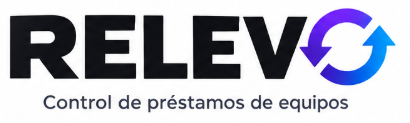

# Relevo: control de préstamos de equipo

Aplicación web interna para registrar qué equipo tiene cada persona, cuándo debe devolverlo y cuándo toca su mantenimiento. Reemplaza el Excel de laptops, monitores y cables que hoy nadie actualiza.

## Índice de documentación

| Documento | Contenido |
|-----------|-----------|
| [Planificación](docs/planificacion.md) | Plan de trabajo semana por semana |
| [Especificaciones de la base de datos](Relevo-db/especificaciones.md) | Modelo final, relaciones, reglas y estados |
| [Diccionario de datos](Relevo-db/diccionario-de-datos.md) | Tablas, columnas y restricciones |
| [Script SQL del esquema](Relevo-db/sql/01-esquema.sql) | Crea las tablas, índices y restricciones en PostgreSQL |

Diagramas:

- [Conceptual](<Relevo-db/diagramas/relevo-bd-1. Conceptual.drawio.svg>)
- [Físico](<Relevo-db/diagramas/relevo-bd-2. Físico.drawio.svg>)
- [Estados del préstamo](<Relevo-db/diagramas/relevo-bd-3. Estados del préstamo.drawio.svg>)
- [Estados del equipo](<Relevo-db/diagramas/relevo-bd-4. Estados del equipo.drawio.svg>)
- [Estados de la solicitud](<Relevo-db/diagramas/relevo-bd-5. Estados de la solicitud.drawio.svg>)

## Problema

- No se sabe quién tiene cada equipo ni cuándo debe devolverlo.
- El Excel no impide anotar dos veces el mismo equipo.
- Nadie avisa cuando un préstamo vence; depende de que alguien revise registro por registro.
- No hay historial confiable de quién recibió cada equipo.

## Solución

- Disponibilidad de cada equipo siempre al día.
- Un equipo solo puede tener un préstamo abierto a la vez, garantizado por el servidor.
- Revisión diaria automática que detecta préstamos vencidos y mantenimientos pendientes, y genera avisos dentro del sistema.
- Historial de préstamos y mantenimientos por equipo.

## Usuarios y roles

| Rol | Puede |
|-----|-------|
| **Usuario** | Consultar sus equipos y préstamos; solicitar un equipo o más tiempo para un préstamo. |
| **Encargado** | Gestionar préstamos y devoluciones; atender solicitudes; consultar inventario y avisos. |
| **Administrador** | Todo lo del encargado, y además gestionar equipos y cuentas. |

El servidor decide qué puede hacer cada rol; la interfaz solo oculta opciones.

Quien recibe un equipo no necesita cuenta: solo la tiene si entra al sistema con el rol Usuario.

## Funciones del MVP

1. **Inicio de sesión:** usuario, encargado y administrador.
2. **Equipos y mantenimiento:** crear, editar y dar de baja equipos. Un equipo sin historial se elimina; con historial se da de baja para conservar sus registros. Cada equipo guarda su último y próximo mantenimiento.
3. **Préstamos:** crear, ver y editar. Solo se eliminan si fueron un error, no tienen devolución y se registra el motivo.
4. **Devoluciones:** registrar y consultar equipos activos, devueltos y vencidos.
5. **Solicitudes:** el rol Usuario pide un equipo o más tiempo; el encargado aprueba o rechaza. Una solicitud no aparta el equipo, solo el préstamo lo hace.
6. **Revisión diaria automática:** avisos de préstamos vencidos y mantenimientos pendientes.

## Reglas que el servidor no deja romper

- **Un equipo, un préstamo abierto:** un índice único parcial en PostgreSQL rechaza duplicados aunque lleguen al mismo tiempo.
- **Todo o nada:** registrar el préstamo y actualizar la disponibilidad del equipo ocurren en una sola transacción.
- **Nada se borra sin rastro:** la auditoría guarda usuario, motivo y datos mínimos de cada registro eliminado o dado de baja.
- **Fechas coherentes:** la fecha prevista de devolución debe ser posterior a la de salida.

## Revisión diaria

1. Se ejecuta sola una vez al día, a la hora y zona horaria configuradas.
2. Busca préstamos cuya fecha prevista ya pasó y mantenimientos pendientes.
3. Crea **un solo aviso** por préstamo o mantenimiento y fecha; un índice único evita duplicados aunque la revisión se repita.
4. El aviso se resuelve al registrar la devolución o el mantenimiento.
5. Si la ejecución falla, se registra el error y la siguiente vuelve a buscar todos los vencidos.

Condición: el servidor debe estar activo para que la revisión se ejecute.

## Alcance

**Incluido:** inventario de equipos, préstamos y devoluciones, solicitudes, mantenimiento por equipo, revisión diaria y avisos dentro del sistema, historial y tres roles.

**Descartado:** avisos por correo, avisos por WhatsApp, códigos QR.

## Modelo de datos

Son 10 tablas en PostgreSQL, con nombres en singular:

- `usuario`: cuentas que entran al sistema (usuario, encargado o administrador).
- `persona`: quien recibe los equipos; puede no tener cuenta.
- `equipo`: inventario, estado, último y próximo mantenimiento.
- `prestamo`: equipo, persona que recibe, fecha de salida, fecha prevista y fecha real de devolución.
- `mantenimiento`: historial por equipo.
- `solicitud`: peticiones de equipo o de más tiempo del rol Usuario.
- `aviso`: préstamos vencidos y mantenimientos pendientes, sin duplicados.
- `ejecucion_revision`: registro de cada revisión diaria.
- `configuracion`: hora y zona horaria de la revisión diaria.
- `auditoria`: usuario, motivo y datos mínimos de cada cambio sensible.

El detalle está en las [especificaciones](Relevo-db/especificaciones.md) y el [diccionario de datos](Relevo-db/diccionario-de-datos.md); el esquema se crea con [01-esquema.sql](Relevo-db/sql/01-esquema.sql).

## Stack

| Capa | Tecnología |
|------|------------|
| Interfaz | React |
| Servidor | Node.js con Express |
| Base de datos | PostgreSQL |
| Automatización | Tarea programada en el servidor para la revisión diaria |

## Puesta en marcha

_Pendiente: se completará cuando exista el código._

## Pruebas

_Pendiente. Deben cubrir: permisos por rol, rechazo de préstamos duplicados (incluso concurrentes), repetición de la revisión sin duplicar avisos y el recorrido completo de crear, consultar, corregir, eliminar con motivo y devolver._

## Plan de trabajo (propuesta)

Detalle semana por semana en [docs/planificacion.md](docs/planificacion.md).

| Semana | Trabajo |
|--------|---------|
| 3 | Proyecto, esquema de datos, inicio de sesión y roles |
| 4 | Equipos (CRUD) · **Reunión 1** a mitad de semana |
| 5 | Préstamos con reglas de concurrencia · **Reunión 2** al final |
| 6 | Devoluciones, activos, devueltos y vencidos, mantenimiento |
| 7 | Historial de mantenimiento · **Reunión 3** a mitad de semana · inicio de la revisión diaria mínima |
| 8 (primera mitad) | Revisión diaria completa, pruebas de permisos y concurrencia, datos de demostración y ensayo · **Demo Day** |
